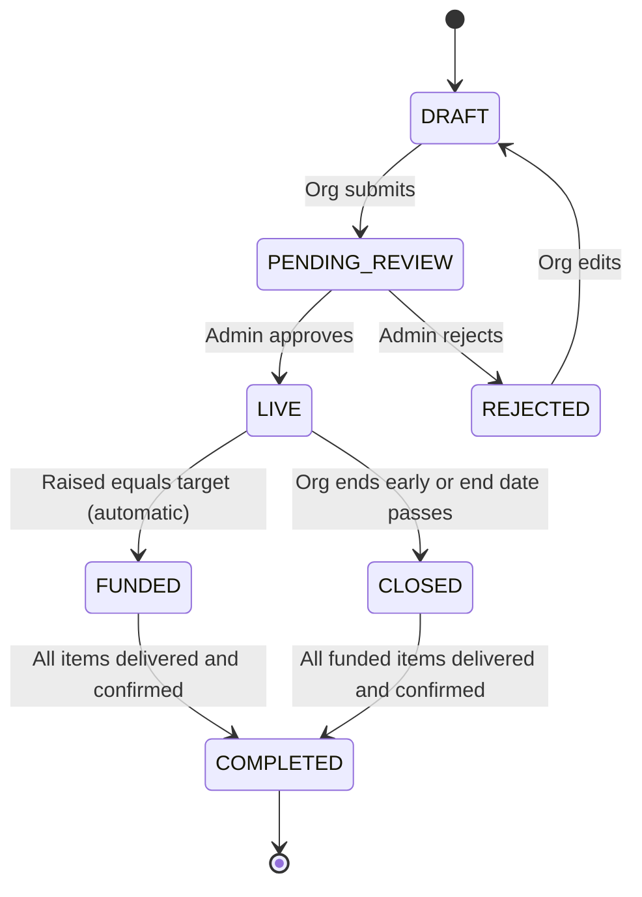

# Amanah MVP: Development Specification

**Date:** 18 October 2026
**Status:** Ready to build. Items marked `[PLACEHOLDER]` or listed under Open Decisions still need a team decision.

This document is the build brief for the Amanah MVP. It is written to be handed to a fresh development session with no other context.

---

## 1. Context

**What Amanah is.** A transparent Islamic donation platform. Verified Islamic organisations (mosques, orphanages, Islamic societies, community groups) publish specific needs. Donors give to those needs and follow exactly how the money is spent through a live accountability page. "Amanah" means trust: the obligation to safeguard what is placed in one's care.

**Why it is being built.** Entry for the AMETTSA Inter-Varsity Innovation Challenge (AMETTSA 5.0 Annual Convention, Summit University, Offa, Kwara State).

- Submission deadline: **1 November 2026**
- Live demo at the convention: `[PLACEHOLDER: convention date]`

**MVP goal.** A simple, solid, demonstrable product. Sharia compliance must be enforced by the system, not by policy text alone.

**Hard boundaries.**

- Strictly general donations. **Zakat and waqf are out of scope** and must not appear anywhere in the product.
- Keep the build simple. When in doubt, cut scope rather than add complexity.

---

## 2. Scope

### In scope (MVP)

1. Organisation registration and manual verification by a platform admin
2. Campaign creation with an itemised list of needs and a fixed target amount
3. Public campaign page with a live accountability view
4. Donations via a payment provider in **test mode**
5. **Automatic donation cap**: no donation accepted beyond the target (see Section 4)
6. Expense logging against a campaign, with receipt photo and evidence photos captured in the app
7. Witness assignment and delivery confirmation
8. Campaign updates (short posts from the organisation)
9. Donor email receipts and milestone notifications `[PLACEHOLDER: confirm email is in scope, otherwise on-screen receipt only]`
10. Responsive web app that works well on mobile browsers

### Out of scope (post-MVP)

- Zakat and waqf (permanently out of this project)
- Direct payments to suppliers or contractors
- Native mobile apps
- SMS confirmation (unless chosen in Open Decisions)
- Recurring donations
- Automated refunds
- Multi-currency (NGN only)
- Live money (test mode only for the demo)
- Platform fees or donor tips

---

## 3. Users and roles

| Role | Who | Can do |
| --- | --- | --- |
| Donor | Any member of the public | Browse campaigns, donate, view accountability pages, receive receipts |
| Organisation admin | A verified representative of an organisation | Create and manage campaigns, log expenses, upload evidence, post updates, assign witnesses |
| Witness | A respected community member appointed per campaign | View assigned campaigns, confirm or dispute delivery |
| Platform admin | The Amanah team | Verify organisations, review campaigns before they go live, view audit log, handle flagged excess |

**Rules**

- An organisation cannot publish a campaign until a platform admin has verified it.
- A witness cannot be an admin of the organisation running the campaign.
- Donors can check out as guests with name, email and phone. `[PLACEHOLDER: confirm guest-only vs optional donor accounts]`

---

## 4. Sharia rules and enforcement

### 4.1 Donation cap (hard requirement)

When a campaign is published with a target amount, the organisation may not receive anything beyond that target.

| Rule | Requirement |
| --- | --- |
| R1 | Every campaign has a fixed target amount, set before publishing. It cannot be raised after the first donation. |
| R2 | The system never accepts a donation that would take confirmed funds above the target. |
| R3 | When confirmed funds equal the target, the campaign moves to `FUNDED` automatically and stops accepting donations. |
| R4 | A donation larger than the remaining amount is handled per Open Decision D1 (decline, or offer the remaining amount). |
| R5 | If excess is ever received through an edge case, it is flagged, returned to the donor, or, where return is not feasible, passed to Bayt al-Mal. In the MVP this is a manual admin action. |

**Priority:** prevention. Excess handling (R5) exists only as a safety net.

### 4.2 Why this is harder than it looks: concurrency

If two donors start paying for the last ₦100,000 at the same moment, a naive "check remaining, then charge" approach lets both succeed and the campaign overshoots. The cap must be enforced with **reservations**.

**Definitions (all amounts in kobo, integers)**

- `raised` = sum of confirmed donations
- `reserved` = sum of active, unexpired reservations
- `available = target - raised - reserved`

**Checkout flow**

1. Donor submits an amount.
2. In a single database transaction, lock the campaign row (`SELECT ... FOR UPDATE`).
3. Compute `available`. If `amount > available`, apply D1. If `available == 0`, reject with "Target reached or fully reserved".
4. Create a `Reservation` (amount, expiry = now + TTL, status `ACTIVE`). Commit.
5. Initialise the payment with the provider, using the reservation ID as the payment reference.
6. Redirect the donor to the provider's checkout.

**Confirmation flow (webhook)**

1. Verify the webhook signature.
2. Verify the transaction directly with the provider's verify endpoint. Never trust the webhook body alone.
3. In one transaction, lock the campaign row and the reservation.
4. If the reservation is `ACTIVE` (or expired but campaign still has room): create the `Donation`, mark reservation `CONFIRMED`, add to `raised`.
5. If `raised == target`, move the campaign to `FUNDED`.
6. If confirming would push `raised` above target (late payment after expiry), confirm only up to the remaining amount, record the rest as `EXCESS_PENDING_RETURN`, and alert the platform admin (R5).
7. The handler must be idempotent: a repeated webhook for the same reference does nothing.

**Expiry**

- A scheduled job (or lazy check at read time) marks reservations past expiry as `EXPIRED` and releases them.
- TTL default: 15 minutes `[PLACEHOLDER: confirm TTL]`.

**UI states**

- `available > 0`: Donate button enabled, shows remaining amount.
- `available == 0` but `raised < target`: "Target nearly reached. Pending payments are being processed." Donate disabled.
- `FUNDED`: "Target reached. Donations closed." Donate permanently disabled.

### 4.3 Proposed rules (pending team decision)

Not yet approved. See Open Decision D8 before building any of these.

- **Purpose lock:** funds given for a stated purpose must be used for it. Lock title, purpose and items after the first donation.
- **No riba:** campaign funds must not earn interest. Policy statement for the MVP.
- **Permissible purposes only:** admin review rejects campaigns for anything impermissible. A checklist item in campaign review.
- **Anonymous giving:** a toggle that hides the donor's name publicly.

---

## 5. Campaign lifecycle

| State | Accepts donations | Notes |
| --- | --- | --- |
| DRAFT | No | Editable by org |
| PENDING_REVIEW | No | Waiting for platform admin |
| REJECTED | No | Admin gives a reason |
| LIVE | Yes, up to target | Public |
| FUNDED | No | Entered automatically at target |
| CLOSED | No | Ended below target; funds still used for the stated purpose |
| COMPLETED | No | Final report available to donors |

Expenses, evidence and witness confirmations can be added in `LIVE`, `FUNDED` and `CLOSED`.

---

## 6. Data model

All money fields are integers in **kobo**. All tables have `id` (UUID), `created_at`, `updated_at`.

| Entity | Key fields | Rules |
| --- | --- | --- |
| User | name, email, phone, password_hash, role (`ORG_ADMIN`, `WITNESS`, `PLATFORM_ADMIN`) | Donors are not users in the MVP unless D7 changes this |
| Organisation | name, type, address, city, state, registration_number, contact_person, verification_status (`PENDING`, `VERIFIED`, `REJECTED`), verification_notes, documents[] | Only `VERIFIED` orgs can publish |
| OrganisationMember | organisation_id, user_id | Links org admins to orgs |
| Campaign | organisation_id, title, slug, purpose, description, cover_image, target_amount, raised_amount, status, end_date (optional), published_at, funded_at | `raised_amount` updated only inside the confirmation transaction; `target_amount` immutable after first donation |
| CampaignItem | campaign_id, name, quantity, unit_cost, total_cost, status (`NEEDED`, `PURCHASED`, `DELIVERED`) | Sum of `total_cost` must equal `target_amount` |
| Reservation | campaign_id, amount, donor_email, status (`ACTIVE`, `CONFIRMED`, `EXPIRED`, `CANCELLED`), expires_at | ID doubles as payment reference |
| Donation | campaign_id, reservation_id, donor_name, donor_email, donor_phone, amount, provider, provider_reference, paid_at, is_anonymous `[PLACEHOLDER: D8]` | Unique on `provider_reference` |
| ExcessRecord | donation_id, amount, status (`PENDING_RETURN`, `RETURNED`, `SENT_TO_BAYT_AL_MAL`), resolved_by, notes | Safety net for R5 |
| Expense | campaign_id, campaign_item_id (optional), description, amount, vendor_name, spent_at, receipt_evidence_id | Total expenses cannot exceed `raised_amount` |
| Evidence | campaign_id, expense_id (optional), type (`RECEIPT`, `PHOTO`), file_url, latitude, longitude, captured_at_client, uploaded_at_server, uploaded_by | Server timestamp is authoritative |
| WitnessAssignment | campaign_id, witness_user_id, assigned_by | Witness must not be an org admin of that org |
| DeliveryConfirmation | campaign_id, campaign_item_id, witness_user_id, status (`CONFIRMED`, `DISPUTED`), comment | A disputed item cannot be marked delivered |
| CampaignUpdate | campaign_id, body, images[], posted_by | Shown in the timeline |
| AuditLog | actor_id, action, entity_type, entity_id, payload (JSON) | Append-only, no updates or deletes |

**Derived values on the accountability page**

- Remaining to raise = `target_amount - raised_amount`
- Spent = sum of `Expense.amount`
- Balance held = `raised_amount - spent`
- Progress = `raised_amount / target_amount`

---

## 7. Pages and flows

### Public

| Page | Purpose |
| --- | --- |
| Home / campaign list | Live and recently completed campaigns, filter by city or organisation |
| Campaign page | Description, items, donate panel, and the accountability section below |
| Checkout | Amount, name, email, phone; redirects to provider |
| Donation result | Success or failure, receipt reference |
| Organisation profile | Verified badge, past campaigns and their completion record |

### Accountability section (the core feature)

Shown on every campaign page:

- Target, raised, remaining, progress bar
- Status badge (including "Target reached. Donations closed.")
- Items table with status (needed, purchased, delivered) and witness confirmation per item
- Expenses list with receipt thumbnails, amounts and dates
- Evidence gallery with capture time and location
- Spent vs balance held
- Updates timeline, newest first

### Organisation dashboard

- Organisation profile and verification documents upload
- Create and edit campaign (draft), add items, submit for review
- Campaign detail: donations received, log expense, capture evidence, post update, assign witness, close campaign early

### Witness view

- List of assigned campaigns
- Per item: view expense and evidence, then confirm or dispute with a comment

### Platform admin

- Organisation verification queue
- Campaign review queue (including permissible-purpose check if D8 approves it)
- Excess records needing action
- Audit log viewer

### In-app evidence capture

- Use `<input type="file" accept="image/*" capture="environment">` and the browser Geolocation API.
- Record client capture time and coordinates; the server upload time is authoritative.
- Compress images client-side before upload (low-bandwidth users).
- Honest limitation: a web browser cannot guarantee a photo came from the camera rather than the gallery. The MVP treats location plus server timestamp plus witness confirmation as the trust signal. A native app can enforce camera-only post-MVP.

---

## 8. Integrations and API

### Payments

- Provider: Paystack in test mode `[PLACEHOLDER: D3]`
- Initialise a transaction with amount in kobo, donor email, and `reference = reservation.id`
- Redirect to the provider's hosted checkout
- Webhook: verify the signature header with the secret key, then call the provider's verify endpoint before confirming
- Settlement to organisations: see D4

### Endpoints (indicative)

| Method | Path | Purpose |
| --- | --- | --- |
| GET | /api/campaigns | List public campaigns |
| GET | /api/campaigns/:slug | Campaign with accountability data |
| POST | /api/campaigns/:id/checkout | Create reservation and initialise payment |
| POST | /api/webhooks/payments | Payment provider webhook |
| GET | /api/donations/:reference | Donation status for the result page |
| POST | /api/org/campaigns | Create campaign (draft) |
| PATCH | /api/org/campaigns/:id | Edit draft |
| POST | /api/org/campaigns/:id/submit | Submit for review |
| POST | /api/org/campaigns/:id/close | Close early |
| POST | /api/org/campaigns/:id/expenses | Log expense |
| POST | /api/org/campaigns/:id/evidence | Upload evidence |
| POST | /api/org/campaigns/:id/updates | Post update |
| POST | /api/org/campaigns/:id/witnesses | Assign witness |
| POST | /api/witness/items/:id/confirm | Confirm or dispute delivery |
| POST | /api/admin/organisations/:id/verify | Verify or reject organisation |
| POST | /api/admin/campaigns/:id/review | Approve or reject campaign |
| PATCH | /api/admin/excess/:id | Resolve excess record |

### Tech stack

`[PLACEHOLDER: D5]` Suggested for speed of build: Next.js (App Router, TypeScript), PostgreSQL with Prisma, Supabase or similar for auth and file storage, Tailwind CSS. PostgreSQL is recommended because row-level locking makes the donation cap reliable.

---

## 9. Non-functional requirements and security

- **Money:** integers in kobo only. No floating point anywhere.
- **Transactions:** reservation creation and donation confirmation each run in a single database transaction with row locks.
- **Idempotency:** unique constraint on `provider_reference`; webhook handler safe to replay.
- **Audit:** every state change, expense, evidence upload and confirmation writes to the append-only audit log.
- **Access control:** role checks on every org, witness and admin endpoint; org admins can only touch their own organisation's data.
- **Secrets:** payment keys and storage keys in environment variables, never in the client.
- **Mobile-first:** usable on a mid-range Android phone over a slow connection.
- **Data protection:** collect only the donor data needed; follow the Nigeria Data Protection Act. Hide donor contact details from the public page.

---

## 10. Demo script and acceptance criteria

### Demo script (about 5 minutes)

1. Platform admin verifies a seeded organisation.
2. Organisation admin creates a campaign, for example a Ramadan food drive with a target of ₦500,000 and three items, and submits it. Admin approves.
3. Donor A gives ₦300,000. The accountability page updates live.
4. Donor B tries to give ₦300,000. The system applies D1 and only ₦200,000 can be accepted.
5. Donor B completes ₦200,000. The campaign switches to "Target reached. Donations closed." and the donate button is disabled.
6. Organisation admin logs an expense with a receipt and evidence photo taken in the app.
7. Witness confirms delivery of the item.
8. Accountability page shows the full trail: raised, spent, receipts, photos, witness confirmation.

Seed real-looking data from a partner organisation: `[PLACEHOLDER: pilot organisation]`.

### Acceptance criteria

- [ ] An unverified organisation cannot publish a campaign
- [ ] `raised_amount` never exceeds `target_amount`, including under concurrent checkouts (test: fire 20 parallel checkouts whose total exceeds the remaining amount; assert confirmed total is at most the target)
- [ ] Campaign moves to `FUNDED` automatically at target and rejects new checkouts
- [ ] A replayed webhook does not create a duplicate donation
- [ ] Expired reservations release their amount
- [ ] A late payment beyond target creates an `ExcessRecord` and alerts admin
- [ ] Target amount cannot be edited after the first donation
- [ ] Total expenses cannot exceed raised amount
- [ ] Evidence stores location and server timestamp
- [ ] A witness cannot be an admin of the same organisation
- [ ] A disputed item cannot be marked delivered
- [ ] No zakat or waqf terminology appears anywhere in the UI
- [ ] The full demo script runs end to end on a mobile browser

---

## 11. Open decisions

| # | Decision | Options | Default if not decided |
| --- | --- | --- | --- |
| D1 | Donation larger than remaining amount | Decline with message / Offer the remaining amount for the donor to accept | Offer the remaining amount |
| D2 | Witness confirmation channel | In-app witness account / SMS | In-app |
| D3 | Payment provider | Paystack / Flutterwave | Paystack |
| D4 | Settlement to organisations | Provider subaccount per org / Record only (test mode) | Record only for the MVP |
| D5 | Tech stack | Team choice | Suggestion in Section 8 |
| D6 | Reservation TTL | 10 / 15 / 30 minutes | 15 minutes |
| D7 | Donor accounts | Guest checkout only / Optional accounts | Guest only |
| D8 | Proposed Sharia rules (purpose lock, no riba, permissible purposes, anonymous giving) | Include any or none | None until approved |
| D9 | Scholarly advisor and confirmed position on excess funds | Name and ruling | `[PLACEHOLDER]` |
| D10 | Campaign end dates | Optional / Required / None | Optional |
| D11 | Email receipts and notifications | In / Out | `[PLACEHOLDER]` |
